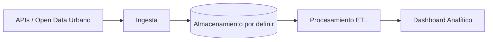

# Proyecto 4 · Big Data Urbano

## Descripción y objetivo
Pipeline completo de ingeniería de datos (batch y streaming) sobre datos abiertos de Valencia (tráfico, calidad del aire y meteorología). Incluye visualización de indicadores consolidados y tiempo real, finalizando con un modelo predictivo de NO₂.

## Arquitectura



## Fuentes de datos
| Fuente | URL / origen | Formato | Frecuencia de actualización | Licencia | Última ingesta |
|---|---|---|---|---|---|
| [Portal Open Data] | [URL] | CSV / API | [Frecuencia] | [Licencia] | [Fecha] |

## Estructura del repositorio
| Carpeta | Contenido |
|---|---|
| `ingesta/` | Scripts de extracción de datos abiertos urbanos |
| `etl/` | Transformaciones y limpieza |
| `dashboard/` | Aplicación de visualización de datos |

## Cómo desplegar el entorno
```bash
# Entorno base preparado. 
# Las instrucciones de despliegue con Docker se añadirán en bloques posteriores.
cp .env.example .env
```

## Bitácora de prácticas

### Bloque 0 · Entorno
- **Objetivo:** Preparar la estructura base de repositorios para el proyecto de datos urbanos.
- **Pasos realizados:** 
  1. Inicialización del repositorio en Git y creación de directorios.
  2. Configuración del archivo `.gitignore`.
  3. Redacción de este documento README.
  *(Nota: Despliegue de contenedores pospuesto a bloques posteriores).*
- **Problemas encontrados y solución:** Ninguno.
- **Resultado:** Repositorio estructurado y listo para el desarrollo.

### Bloque 1 · Ingesta batch
- **Objetivo:** [Pendiente]
- **Pasos realizados:** [Pendiente]
- **Problemas encontrados y solución:** [Pendiente]
- **Resultado:** [Pendiente]

## Decisiones técnicas
| Decisión | Alternativa descartada | Motivo |
|---|---|---|
| [Pendiente] | [ ] | [ ] |

## Incidencias resueltas
- **Problema:** [Pendiente]
- **Causa:** [ ] 
- **Solución:** [ ]